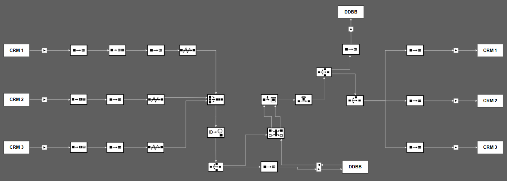

# Resolucion de problema CRM


Participantes:
- Pablo Pistacho
- Ángel Miguel Garcia Marron
- Daniel Pérez Ramírez


---


## Metodologia SCRUM

(insertar diagrama de trabajo)


---

## Explicación del Problema


---

## Diagrama del problema




---

## Explicacion de la solucion

---

<style>
section.crm1 { font-size: 25px; }
section.crm1 pre { font-size: 18px; }
section.crm1 table { font-size: 23px; }
</style>

<!-- _class: crm1 -->

## Conector de entrada de CRM1

El mensaje recibido por el conector de entrada de CRM1 contiene **tres filas y dos cambios**:
Pepe se da de alta con dos direcciones y Ana se da de baja.

```xml
<crm1Changes id="F001">
  <row change="M01" seq="1" action="ALTA" key="CLI-25" clientId="25" name="Pepe">
    <address id="D1">Calle Mayor 12, Huelva</address>
  </row>
  <row change="M01" seq="1" action="ALTA" key="CLI-25" clientId="25" name="Pepe">
    <address id="D2">Avenida Andalucia 45, Sevilla</address>
  </row>
  <row change="M02" seq="2" action="BAJA" key="CLI-90" clientId="90" name="Ana">
    <address id="D8">Calle Industria 14, Malaga</address>
  </row>
</crm1Changes>
```

Las filas de Pepe comparten `change="M01"`. La baja de Ana usa `M02`.

---

<!-- _class: crm1 -->

## Translator de entrada: agrupación del lote

El traductor cambia la raíz `crm1Changes` por `batch`.
Agrupa las filas del mismo cambio dentro de un único `event`.

**Antes:** Pepe ocupa dos filas con sus datos repetidos.
**Después:** ambas direcciones quedan dentro del mismo cliente:

```xml
<customer key="CLI-25" sourceId="25">
  <name>Pepe</name>
  <addresses>
    <address id="D1">Calle Mayor 12, Huelva</address>
    <address id="D2">Avenida Andalucia 45, Sevilla</address>
  </addresses>
</customer>
```

El lote contiene dos eventos: alta de Pepe y baja de Ana.

---

<!-- _class: crm1 -->

## Translator de entrada: cabecera del evento

Cada evento incorpora una cabecera con su origen y operación:

```xml
<header>
  <eventId>CRM1:F001:M01:CLI-25:ALTA</eventId>
  <source>CRM1</source>
  <batchId>F001</batchId>
  <sequence>1</sequence>
  <total>2</total>
  <sourceSequence>1</sourceSequence>
  <operation>ALTA</operation>
</header>
```

`eventId` identifica el cambio. `sequence` indica su posición.
`total=2` cuenta los cambios del lote, aunque la entrada tenga tres filas.
El evento de Ana lleva secuencia 2 y operación `BAJA`.

---

<!-- _class: crm1 -->

## Splitter: separación del lote

El splitter recibe un `batch` con dos eventos y emite dos mensajes.
Cada mensaje tiene raíz `event` y conserva su cabecera y su cliente.

| Salida del Splitter | Operación | Cliente | Direcciones |
| --- | --- | --- | --- |
| Evento de alta | `ALTA` | Pepe, `CLI-25`, ID 25 | D1 y D2. |
| Evento de baja | `BAJA` | Ana, `CLI-90`, ID 90 | D8. |

Desaparece la envoltura `batch` en cada salida.
Las direcciones de Pepe permanecen juntas dentro de su evento.

---

<!-- _class: crm1 -->

## Resequencer, Merger y Replicator

El resequencer ordena los eventos según su secuencia.
El merger incorpora sus mensajes al canal común de procesamiento.
**Ambas tareas mantienen el contenido del evento.**

Antes de la consulta, cada intento recibe un `correlationId`:

```xml
<correlationId>INTENTO-CRM1-ALTA-001</correlationId>
```

El replicator crea dos copias iguales: una espera la respuesta
y la otra se transforma en una consulta a la BD auxiliar.

Estos pasos no tienen archivos independientes en el ZIP de CRM1.

---

<!-- _class: crm1 -->

## Translator de consulta a la BD auxiliar

El Translator de consulta recibe el evento y produce un `query`.
`statement` contiene la consulta SQL y `parameters` sus valores:

```xml
<parameters>
  <param name="clave_cliente">CLI-25</param>
  <param name="origen">CRM1</param>
  <param name="operacion">ALTA</param>
  <param name="evento_id">CRM1:F001:M01:CLI-25:ALTA</param>
</parameters>

```

La consulta busca el estado y el ID local del cliente en cada CRM.
Usa `clientes_sync` y `entregas_sync`, de la **BD auxiliar**.
El conector ejecuta el SQL enlazando estos parámetros.

---

<!-- _class: crm1 -->

## Translator de consulta: alta y baja

El Translator de consulta utiliza la misma sentencia SQL para el alta
y la baja. Cambian los valores de los parámetros de entrada.

| Parámetro | Alta de Pepe | Baja de Ana |
| --- | --- | --- |
| `clave_cliente` | `CLI-25` | `CLI-90` |
| `origen` | `CRM1` | `CRM1` |
| `operacion` | `ALTA` | `BAJA` |
| `evento_id` | Identificador del alta M01. | Identificador de la baja M02. |

El `CASE` calcula `pendiente` según la operación y el estado.
CRM1 queda con `pendiente=false` porque es el origen del cambio.

---

<!-- _class: crm1 -->

## Conector de BD: respuesta de la consulta del alta

El conector recibe un `query` y devuelve un `queryResult`.
La BD devuelve tres filas, una por CRM. Esta es la de CRM2:

```xml
<row>
  <crm>CRM2</crm>
  <id_local null="true" />
  <estado_crm>AUSENTE</estado_crm>
  <fecha_alta null="true" />
  <estado_entrega>NUEVA</estado_entrega>
  <pendiente>true</pendiente>
</row>
```

Pepe está `ACTIVO` en CRM1 y `AUSENTE` en CRM2 y CRM3.
Los dos destinos quedan pendientes de alta.
`null="true"` representa un valor NULL devuelto por SQL.

---

<!-- _class: crm1 -->

## Conector de BD: respuesta de la consulta de baja

El conector de BD devuelve el estado de Ana en cada CRM.
La fila de CRM2 contiene los datos necesarios para su baja:

```xml
<row>
  <crm>CRM2</crm>
  <id_local>190</id_local>
  <estado_crm>ACTIVO</estado_crm>
  <fecha_alta>2026-09-10T10:05:00+02:00</fecha_alta>
  <estado_entrega>NUEVA</estado_entrega>
  <pendiente>true</pendiente>
</row>
```

Ana está `INACTIVO` en CRM1, pero sigue `ACTIVO` en los destinos.
CRM3 devuelve su propio ID, **290**, también con `pendiente=true`.

---

<!-- _class: crm1 -->

## Correlator y Content Enricher: alta

El correlator empareja el evento y la respuesta por `correlationId`.
El Content Enricher conserva `header` y `customer` y añade `state`.

**Fragmento que añade el Content Enricher para CRM2:**

```xml
<target system="CRM2" id="" pending="true" status="AUSENTE" registeredAt="" />
```

**También añade la decisión:**

```xml
<decision action="APPLY" />
```

El estado de cada destino permite decidir dónde aplicar el alta.
La operación original continúa siendo `ALTA`.

---

<!-- _class: crm1 -->

## Content Enricher: baja

El Content Enricher conserva los datos de Ana y su operación `BAJA`.
Añade los IDs locales y el estado conocido de cada destino.

**Fragmentos de los destinos añadidos a `state/targets`:**

```xml
<target system="CRM2" id="190" pending="true" status="ACTIVO" registeredAt="2026-09-10T10:05:00+02:00" />

<target system="CRM3" id="290" pending="true" status="ACTIVO" registeredAt="2026-09-10T10:06:00+02:00" />
```

El ID 90 del origen no sirve para borrar a Ana en los otros CRM.
La consulta aporta **190 para CRM2** y **290 para CRM3**.
El evento enriquecido también contiene `decision action="APPLY"`.

---

<!-- _class: crm1 -->

## Filter y Replicator: evento enriquecido

El filtro central recibe los eventos de alta y baja del Content Enricher.
Ambos contienen `decision action="APPLY"` y continúan el recorrido.
**El filtro deja pasar el XML sin modificarlo.**

Después, los replicators generan copias del mismo evento:

| Rama del diagrama | Qué ocurre con el mensaje |
| --- | --- |
| BD superior | Una copia se dirige al traductor de escritura en la BD. |
| Salidas a los CRM | Otras copias se dirigen a los traductores de destino. |

Los traductores de salida adaptan las copias a los formatos de CRM2 y CRM3.

<!-- El diagrama tiene un filtro central, sin filtros individuales en las salidas.
El replicator copia mensajes, no selecciona destinos por sí mismo.
El ZIP de CRM1 no incluye un XML para la rama de escritura en la BD superior.
No se inventa una sentencia ni una confirmación para esa rama. -->

---

<!-- _class: crm1 -->

## Translator de salida a CRM2: alta

El traductor sustituye el evento enriquecido por una petición RPC.
Su salida contiene el método y los datos para dar de alta a Pepe:

```xml
<rpcRequest eventId="CRM1:F001:M01:CLI-25:ALTA">
  <method>darAltaCliente</method>
  <params>
    <businessKey>CLI-25</businessKey>
    <name>Pepe</name>
    <addresses>
      <address id="D1">Calle Mayor 12, Huelva</address>
      <address id="D2">Avenida Andalucia 45, Sevilla</address>
    </addresses>
  </params>
</rpcRequest>
```

`businessKey` procede de `customer/@key`. `name` y `addresses`
conservan sus valores. El estado interno deja de formar parte del mensaje.

---

<!-- _class: crm1 -->

## Translator de salida a CRM2: baja

El Translator de salida a CRM2 transforma el evento en esta petición RPC:

```xml
<rpcRequest eventId="CRM1:F001:M02:CLI-90:BAJA">
  <method>darBajaCliente</method>
  <params>
    <businessKey>CLI-90</businessKey>
    <clientId>190</clientId>
  </params>
</rpcRequest>
```

`operation=BAJA` determina el método `darBajaCliente`.
`clientId=190` procede del estado de CRM2 añadido por el enricher.
La baja solo envía la clave y el ID local que necesita el método.

---

<!-- _class: crm1 -->

## Translator de salida a CRM3: alta

El evento pasa a ser un `sqlTransaction` con **tres sentencias**:
una para el cliente y una para cada dirección.

**Primera sentencia y parámetros que produce el Translator:**

```xml
<statement>INSERT INTO clientes (clave, nombre) VALUES (:clave, :nombre)
ON CONFLICT(clave) DO NOTHING;<parameters>
    <param name="clave">CLI-25</param>
    <param name="nombre">Pepe</param>
  </parameters>
</statement>

```

`clave` y `nombre` se obtienen del cliente del evento.
`ON CONFLICT(clave) DO NOTHING` evita repetir una clave existente.
El conector ejecuta las tres sentencias dentro de una transacción.

---

<!-- _class: crm1 -->

## Translator de salida a CRM3: direcciones

Cada `address` del evento genera una sentencia parametrizada.
Para D1, el Translator produce:

```xml
<statement>INSERT INTO direcciones (cliente_id, codigo, texto)
SELECT id, :codigo, :texto FROM clientes WHERE clave = :clave
ON CONFLICT(cliente_id, codigo) DO UPDATE SET texto = excluded.texto;<parameters>
    <param name="clave">CLI-25</param>
    <param name="codigo">D1</param>
    <param name="texto">Calle Mayor 12, Huelva</param>
  </parameters>
</statement>

```

La tercera sentencia utiliza D2 y su dirección de Sevilla.
El `SELECT` obtiene el ID asignado al cliente en CRM3.

---

<!-- _class: crm1 -->

## Translator de salida a CRM3: baja

El traductor convierte el evento de baja en un `DELETE`.
El XML que produce el Translator contiene:

```xml
<sqlTransaction eventId="CRM1:F001:M02:CLI-90:BAJA">
  <statement>DELETE FROM clientes WHERE id = :id_local AND clave = :clave;<parameters>
      <param name="id_local">290</param>
      <param name="clave">CLI-90</param>
    </parameters>
  </statement>
</sqlTransaction>
```

`id_local=290` procede de la respuesta de la BD para CRM3.
`clave=CLI-90` procede del cliente original.
En el esquema de ejemplo, `ON DELETE CASCADE` elimina sus direcciones.

---

<!-- _class: crm1 -->

## Evolución de los XML del ejemplo CRM1

| Tarea | Cambio que se observa |
| --- | --- |
| Translator de entrada de CRM1 | Filas por dirección se agrupan en eventos por cambio. |
| Splitter | El lote se separa en un alta y una baja. |
| Translator de consulta a la BD | El evento se convierte en SQL y parámetros. |
| Conector de BD | La BD devuelve filas con IDs y estados. |
| Content Enricher | El evento incorpora estado por destino y decisión. |
| Translator de salida a CRM2 | El evento se adapta a una petición RPC para CRM2. |
| Translator de salida a CRM3 | El evento se adapta a una transacción SQL para CRM3. |

Ejemplos completos: [ZIP del camino de CRM1](CRM1-camino-alta-y-baja%20%281%29.zip).
